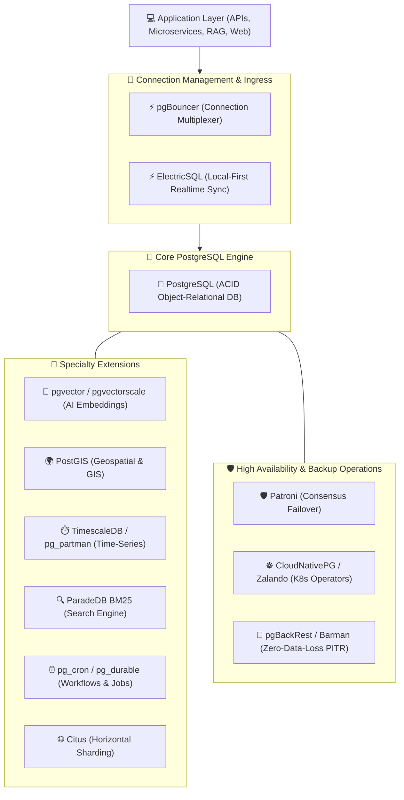

# 🐘 Awesome Relational Databases & PostgreSQL Extensions 🚀

  

  
  
  
  
  
  

---

## 📌 Executive Summary & SEO Keywords 🔍

Welcome to the definitive, community-curated directory of **Relational Databases (RDBMS)**, **Managed PostgreSQL SaaS Platforms (DBaaS)**, **PostgreSQL Extensions**, **Vector Databases**, and **High-Availability Cloud Infrastructure**. 

PostgreSQL has evolved into the universal data engine—combining ACID relational storage, vector similarity search (`pgvector`), AI workflows (`pg_durable`, `pg_vectorize`, `PostgresML`), geospatial analytics (`PostGIS`), distributed horizontal scale (`Citus`), and time-series metrics (`TimescaleDB`).

*Keywords: PostgreSQL, Relational Database, RDBMS, Postgres Extensions, Managed Postgres, Cloud SQL, Aurora PostgreSQL, Supabase, Neon Serverless Postgres, pgvector, Vector Search, Time-Series, Citus, Distributed SQL, PostGIS, High Availability, Patroni, pgBouncer, CloudNativePG, Database-as-a-Service, DBaaS.*

---

## 📑 Table of Contents 📖

- [📊 Sector Overview & Market Dynamics](#-sector-overview--market-dynamics)
- [☁️ SaaS & Hosted PostgreSQL Platforms](#️-saas--hosted-postgresql-platforms)
- [💻 Open-Source PostgreSQL Projects & Extensions](#-open-source-postgresql-projects--extensions)
  - [🏆 Ranked by GitHub_Stars](#-ranked-by-github-stars)
  - [🧱 Categorized Architecture & Tooling](#-categorized-architecture--tooling)
- [🤝 How to Contribute](#-how-to-contribute)
- [💖 Support & Sponsorship](#-support--sponsorship)
- [📈 Star History](#-star-history)
- [⚠️ Disclaimer](#️-disclaimer)

---

## 📊 Sector Overview & Market Dynamics 📈

The global relational database management system (RDBMS) and managed cloud database (DBaaS) market is estimated at **$90 Billion to $105 Billion in 2026**, growing at a robust CAGR of ~12–14%, fueled by enterprise cloud migration and generative AI vector workloads.

The sector demonstrates **moderate fragmentation with an oligopolistic hyperscaler core**: while public cloud giants (AWS, Microsoft Azure, Google Cloud) command roughly 65–70% of hosted infrastructure revenue, high developer specialization and open-source innovation have fostered high-growth category champions (e.g., Supabase, Neon, Timescale, Aiven, Crunchy Data) that capture substantial market share through developer ergonomics, serverless branching, and purpose-built extension ecosystems.

---

## ☁️ SaaS & Hosted PostgreSQL Platforms 🏢

The table below lists leading managed PostgreSQL and cloud relational database providers, sorted in descending order by estimated company size (market valuation or annual revenue run-rate / market cap).

| 🏢 Platform | 💰 Company Size (Valuation / Revenue) | 🏷️ Pricing Model & Starting Tier | 🎁 Free Tier / Free Trial Limits | 🌟 Highlights & Focus |
| :--- | :--- | :--- | :--- | :--- |
| **[Microsoft Azure Database for PostgreSQL](https://azure.microsoft.com/en-us/products/postgresql/)** | **~$3.1 Trillion** (Parent Market Cap; Cloud Rev >$130B/yr) | Flexible Server starts at **~$12.50/month** (B1ms instance: 1 vCPU, 2 GiB RAM, $0.017/hr + storage) | **12 Months Free Trial** of Flexible Server with 750 compute hours/month (B1ms) + 64 GB storage & 750 hrs backup storage | Flexible Server, Citus Hyperscale, Azure AI / OpenAI extensions integration. |
| **[Google Cloud SQL for PostgreSQL](https://cloud.google.com/sql/docs/postgres)** | **~$2.1 Trillion** (Parent Market Cap; Cloud Rev >$40B/yr) | Shared-core micro instance starts at **~$9.60/month** (db-f1-micro, 1 vCPU, 0.6 GB RAM at ~$0.013/hr + storage) | **$300 Free Trial Credit** valid for 90 days across Google Cloud services | Vertex AI vector integration, AlloyDB high-performance tier, automatic HA. |
| **[AWS RDS / Aurora PostgreSQL](https://aws.amazon.com/rds/postgresql/)** | **~$2.1 Trillion** (Parent Market Cap; Cloud Rev >$105B/yr) | Single-AZ db.t4g.micro starting at **~$13.14/month** (~$0.018/hr + gp3 storage at $0.115/GB-mo) | **12 Months Free Tier**: 750 hrs/month of db.t2.micro / db.t3.micro / db.t4g.micro + 20 GB SSD storage & 20 GB backups | Industry-standard enterprise managed Postgres, Aurora multi-master & serverless v2. |
| **[Aiven for PostgreSQL](https://aiven.io/postgresql)** | **~$3 Billion** (Valuation, Series D) | Startup plan starts at **$19/month** (Single node, 1 vCPU, 2 GB RAM, 25 GB storage) | **30-Day Free Trial** with **$300 platform credits** to deploy clusters | Multi-cloud managed services across AWS, GCP, and Azure with 99.99% SLA. |
| **[Supabase](https://supabase.com/)** | **~$1.5 Billion** (Valuation, Series C) | Pro tier starts at **$25/month** (includes 8 GB database, compute credits, 100k MAU) | **Free Forever Plan**: 2 free projects, 500 MB database space, 5 GB egress, 50k monthly active users (MAU) | The open-source Firebase alternative: Postgres + pgvector + Auth + Realtime + Edge Functions. |
| **[Neon Serverless Postgres](https://neon.tech/)** | **~$500 Million** (Valuation, Series B) | Launch plan starts at **$19/month** (dedicated compute, branching, autoscaling to 4 CU) | **Free Forever Plan**: 1 project with 10 branches, 0.5 GiB active storage, shared compute up to 1 vCPU / 2 GB RAM | Serverless architecture separating compute from storage, instant branching, scale-to-zero. |
| **[Timescale Cloud](https://www.timescale.com/)** | **~$400 Million** (Valuation, Series B) | Dynamic compute starting at **$31/month** (1 CPU, 4 GB RAM, 25 GB NVMe storage) | **30-Day Free Trial**: Full-featured access with no credit card required upfront | High-speed time-series, hypertables, continuous aggregates, and pgvectorscale DiskANN search. |
| **[Crunchy Bridge](https://www.crunchydata.com/products/crunchy-bridge)** | **~$100M+** (Est. Enterprise Revenue / Market Valuation) | Hobby plan starts at **$35/month** (1 GB RAM, 10 GB storage, high availability ready) | **No Free Forever Tier**: Managed trial upon request / $10 promotional dev credits | Pure PostgreSQL specialists, native extension support (PostGIS, pgvector), enterprise security. |
| **[Tembo Cloud](https://tembo.io/)** | **~$40 Million** (Valuation, Seed/Series A) | Standard compute starting at **$25/month** (1 vCPU, 2 GB RAM) | **Free Forever Hobby Plan**: 1 instance, 0.25 vCPU, 1 GB RAM, 10 GB storage | Curated Postgres "stacks" for vector search, message queues, time-series, and data warehousing. |

---

## 💻 Open-Source PostgreSQL Projects & Extensions 🛠️

PostgreSQL's greatest superpower is its extensible architecture. The ecosystem ranges from vector similarity search to distributed partitioning, high availability, and in-database workflow execution.

### 🏆 Ranked by GitHub_Stars ⭐

All major open-source PostgreSQL repositories, engines, operators, and extensions sorted descending by GitHub Stars_Count:

| 📦 Repository & Link | 🌟 Stars_Badge | 📝 Description & Primary Use Case |
| :--- | :---: | :--- |
| **[supabase/supabase](https://github.com/supabase/supabase)** |  | Open-source Firebase alternative built on top of Postgres with Auth, Vector storage, Realtime APIs, and auto-generated REST/GraphQL. |
| **[timescale/timescaledb](https://github.com/timescale/timescaledb)** |  | Time-series and analytical data engine built as a native Postgres extension with automatic hypertable chunking and columnar compression. |
| **[pgvector/pgvector](https://github.com/pgvector/pgvector)** |  | Open-source vector similarity search for Postgres supporting L2 distance, cosine similarity, inner product with HNSW and IVFFlat index types. |
| **[postgres/postgres](https://github.com/postgres/postgres)** |  | Official mirror of the PostgreSQL object-relational database system; foundational core for the entire modern database landscape. |
| **[citusdata/citus](https://github.com/citusdata/citus)** |  | Distributed PostgreSQL extension that shards tables and distributes SQL queries across multiple worker nodes for multi-tenant and real-time analytics. |
| **[electric-sql/electric](https://github.com/electric-sql/electric)** |  | Real-time synchronization layer for Postgres allowing local-first web and mobile software with sub-millisecond offline reactivity. |
| **[cloudnative-pg/cloudnative-pg](https://github.com/cloudnative-pg/cloudnative-pg)** |  | Modern Kubernetes Operator designed specifically to deploy, manage, and scale cloud-native PostgreSQL clusters declaratively. |
| **[paradedb/paradedb](https://github.com/paradedb/paradedb)** |  | ElasticSearch alternative built natively inside Postgres combining BM25 full-text search (`pg_search`) and vector search (`pg_analytics`). |
| **[patroni/patroni](https://github.com/patroni/patroni)** |  | Production HA template for PostgreSQL using distributed consensus stores (DCS) like etcd, Consul, or Kubernetes for automatic failover. |
| **[postgresml/postgresml](https://github.com/postgresml/postgresml)** |  | In-database machine learning platform for training, fine-tuning, and generating vector embeddings with GPUs directly via SQL queries. |
| **[zalando/postgres-operator](https://github.com/zalando/postgres-operator)** |  | Battle-tested Kubernetes operator that manages highly available PostgreSQL clusters powered by Patroni and Spilo. |
| **[pgbackrest/pgbackrest](https://github.com/pgbackrest/pgbackrest)** |  | High-performance, reliable backup and restore solution designed specifically for multi-terabyte PostgreSQL production databases. |
| **[pgbouncer/pgbouncer](https://github.com/pgbouncer/pgbouncer)** |  | Lightweight, low-memory connection pooler for PostgreSQL, maximizing throughput by multiplexing thousands of client connections. |
| **[citusdata/pg_cron](https://github.com/citusdata/pg_cron)** |  | Cron-based job scheduler for PostgreSQL that executes SQL commands directly within the database on a configured schedule. |
| **[EnterpriseDB/barman](https://github.com/EnterpriseDB/barman)** |  | Backup and Recovery Manager for disaster recovery and physical point-in-time recovery (PITR) of PostgreSQL servers. |
| **[timescale/pgvectorscale](https://github.com/timescale/pgvectorscale)** |  | Open extension complementing pgvector with StreamingDiskANN indexing and statistical binary quantization for billion-scale embeddings. |
| **[pgpartman/pg_partman](https://github.com/pgpartman/pg_partman)** |  | Partition management extension that automates time-series and serial-id partition creation and data retention policies. |
| **[microsoft/pg_durable](https://github.com/microsoft/pg_durable)** |  | PostgreSQL in-database durable execution engine enabling fault-tolerant multi-step workflows, retry policies, and checkpointed functions without external workers. |
| **[postgis/postgis](https://github.com/postgis/postgis)** |  | The gold standard open-source spatial database extender, providing geographic objects, R-tree spatial indexes, and GIS topological analysis. |
| **[tembo-io/tembo](https://github.com/tembo-io/tembo)** |  | Open-source Kubernetes-native PostgreSQL platform designed to build, package, and orchestrate specialty extension stacks. |

---

### 🧱 Categorized Architecture & Tooling 🏛️

- **Vector & AI Workloads**: Combine **pgvector** with **pgvectorscale** for high-dimensional semantic search and DiskANN indexing; execute GPU-accelerated models via **PostgresML**.
- **Geographic & Spatial Systems**: **PostGIS** stands as the unquestioned industry standard for geospatial computing and topological routing.
- **Time-Series & Event Streams**: Use **TimescaleDB** for hypertable partitioning and analytical aggregation, or **pg_partman** for native interval partitioning.
- **Fault-Tolerant In-DB Workflows**: **pg_durable** allows durable workflow orchestrations natively inside Postgres, while **pg_cron** manages background schedules.
- **Enterprise Operations & HA**: Orchestrate Kubernetes deployments using **CloudNativePG** or **Patroni**, backed up continuously by **pgBackRest**.

---

## 🤝 How to Contribute 💡

Contributions are warmly welcomed! Help expand this directory by suggesting innovative extensions or hosted services:

1. 🍴 Fork the repository.
2. 🌿 Create your feature branch (`git checkout -b feature/new-postgres-tool`).
3. ✍️ Add the SaaS or Open-Source project with accurate pricing, links, and stars.
4. 💾 Commit your changes (`git commit -m "Add new PostgreSQL extension"`).
5. 🚀 Push to the branch (`git push origin feature/new-postgres-tool`).
6. 📩 Open a Pull Request!

---

## 💖 Support & Sponsorship ☕

Thank you so much for visiting and utilizing this guide! Maintaining and curating this comprehensive open database index takes continuous effort.

If you find this repository valuable:
- ⭐ **Star this repository** to help others discover it!
- 🍴 **Fork and contribute** your favorite extensions or DBaaS setups.
- 📢 **Share it** with fellow database engineers, platform architects, and developers.
- ☕ **Buy a coffee & sponsor**: If this project helped you in your work or learning, consider showing your support on the [GitHub Sponsors Dashboard](https://github.com/sponsors/ishandutta2007).

  

---

## 📈 Star History

---

## ⚠️ Disclaimer ⚖️

- This is an independent, community-curated list maintained for educational, architectural, and informational purposes. It is not directly affiliated with, sponsored by, or endorsed by the PostgreSQL Global Development Group or any referenced vendor.
- PostgreSQL is a registered trademark of the PostgreSQL Community Association of Canada. All other trademarks, service marks, and company names are property of their respective owners.
- Database extensions run within the database server process space. Always benchmark, security-audit, and verify extension compatibility in staging environments prior to production rollout.

---

  <b>Built with ❤️ for DBAs, platform architects, and developers building the future on PostgreSQL.</b>

